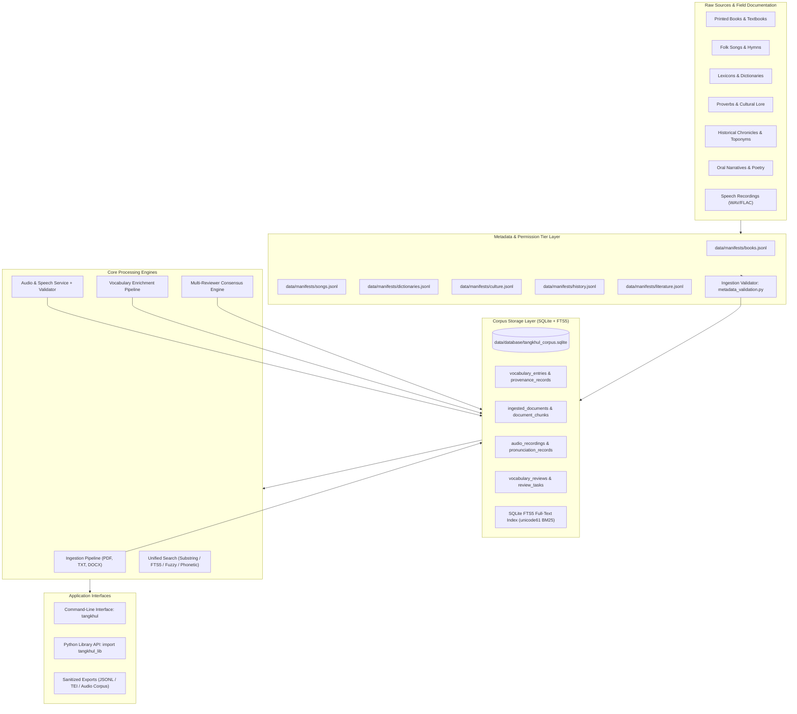

# Tangkhul Language Library (TLL) — Executive Summary & Complete Navigation Guide

> **Project Version**: `0.1.0` | **Status**: Active (Step 15: Audio Corpus & Speech Infrastructure Completed)  
> **Target Language**: Tangkhul Naga (*Tangkhulic*, Tibeto-Burman branch)  
> **Primary Region**: Ukhrul and Kamjong Districts, Manipur, Northeast India & contiguous Myanmar  
> **Test Status**: [](file:///f:/tangkhul-language-library/tests) [](file:///f:/tangkhul-language-library/pyproject.toml)  
> **Architecture Layout**: PEP 517 `src/` layout with typed Python (`py.typed`)  

---

## Table of Contents

1. [Executive Overview & Vision](#1-executive-overview--vision)
2. [Key Metrics & Executive Dashboard](#2-key-metrics--executive-dashboard)
3. [System Architecture & Data Flow](#3-system-architecture--data-flow)
4. [Master File Catalogue & Interactive Navigation](#4-master-file-catalogue--interactive-navigation)
   - [4.1 Core Foundation & Exceptions](#41-core-foundation--exceptions)
   - [4.2 Storage & Database Persistence Layer](#42-storage--database-persistence-layer)
   - [4.3 Ingestion Pipeline & Document Processing](#43-ingestion-pipeline--document-processing)
   - [4.4 Unified Vocabulary Engine & Phonetics](#44-unified-vocabulary-engine--phonetics)
   - [4.5 Six Domain Modules (Books, Songs, Dictionaries, Culture, History, Literature)](#45-six-domain-modules)
   - [4.6 Audio Corpus, Pronunciation & Consent Infrastructure](#46-audio-corpus-pronunciation--consent-infrastructure)
   - [4.7 Command-Line Interface (CLI)](#47-command-line-interface-cli)
   - [4.8 Data Manifests & Storage Directories](#48-data-manifests--storage-directories)
   - [4.9 Operational Scripts](#49-operational-scripts)
   - [4.10 Documentation Suite](#410-documentation-suite)
   - [4.11 Test Suite & Verification Matrix](#411-test-suite--verification-matrix)
5. [Core Subsystems Deep-Dive](#5-core-subsystems-deep-dive)
   - [5.1 Multi-Mode Search & Tangkhul Phonetics](#51-multi-mode-search--tangkhul-phonetics)
   - [5.2 Ethical Permissions, Consent Revocation & Speaker Shielding](#52-ethical-permissions-consent-revocation--speaker-shielding)
   - [5.3 Multi-Reviewer Consensus Engine](#53-multi-reviewer-consensus-engine)
   - [5.4 Digital Document Ingestion & Chunking](#54-digital-document-ingestion--chunking)
   - [5.5 Self-Contained Bundled Storage (Zero External DB Dependency)](#55-self-contained-bundled-storage-zero-external-db-dependency)
6. [Database Schema Reference](#6-database-schema-reference)
7. [CLI Operations Cheatsheet](#7-cli-operations-cheatsheet)
8. [Quality Assurance, Git Hygiene & Testing](#8-quality-assurance-git-hygiene--testing)
9. [Development Roadmap & Next Steps](#9-development-roadmap--next-steps)

---

## 1. Executive Overview & Vision

The **Tangkhul Language Library (TLL)** is a specialized computational toolkit and digital preservation framework engineered for the **Tangkhul Naga language** (a major Tibeto-Burman language of northeast India and western Myanmar).

Historically, indigenous linguistic preservation suffers from three critical bottlenecks:
1. **Isolated Data Silos**: Dictionaries, folk songs, school textbooks, and oral histories exist in detached formats with zero cross-referencing.
2. **Destructive Flattening**: Standardizing orthography often wipes out precious village-level dialect variants (e.g., Ukhrul vs. Raphei, Champhung, Phadang, Huishu).
3. **Loss of Citation & Ethical Violation**: Digital corpora frequently strip original speaker/author attribution or ignore community consent terms.

### Core Architectural Solutions of TLL:
- **Unified Vocabulary Model**: Every lexical lemma links bi-directionally to its original catalogued source, page number, stanzas, or audio recording through immutable provenance records.
- **Dialect & Variation Preservation**: Headwords maintain phonological variants, alternative spellings, and village tags without destructive deduplication.
- **Strict Ethical & Cultural Permissions**: Tiered clearance (`permitted`, `community_authorized`, `public_domain`, `pending`, `restricted`, `withdrawn`) with automated metadata and speaker shielding (`[SHIELDED SPEAKER]`, `[RESTRICTED AUDIO FILE - ACCESS PRIVILEGED]`).
- **Community Consensus Governance**: Offline review packages, independent multi-reviewer thresholds, and conflict tracking keep community sovereignty at the center of verification.
- **Self-Contained Bundled Lexicon**: 262 curated vocabulary entries and an embedded SQLite corpus are packaged directly inside the library (`src/tangkhul_lib/data/`), enabling zero-dependency import and instant lookup anywhere.

---

## 2. Key Metrics & Executive Dashboard

| Dimension | Metric | Status / Description |
|---|---|---|
| **Python Compatibility** | `>= 3.10` | Fully tested on 3.10, 3.11, 3.12 (Matrix CI) |
| **Automated Tests** | **307 Passing** | `pytest -q` runs 100% green with zero failures |
| **Code Hygiene** | **100% Ruff Clean** | Zero lint or formatting warnings under strict PEP rules |
| **Complete Books** | **35 Cover-to-Cover** | 741 total pages, all chapters, page 1 to end page digitized |
| **Catalogued Resources** | **217 Items** | 35 Books, 48 Songs, 16 Dictionaries, 32 Culture, 32 History, 54 Literature |
| **Manifest Integrity** | **0 Duplicate IDs** | Global uniqueness verified across all 6 manifests |
| **Vocabulary Entries** | **262 Curated Lemmas** | Bundled directly inside package (`src/tangkhul_lib/data/`) |
| **External DB Dependency** | **ZERO (Self-Contained)** | Pure Python standard library `sqlite3` + bundled JSONL/TSV |
| **Document Chunks** | **458 Ingested Chunks** | Page-by-page text chunks indexed in FTS5 full-text search |
| **Provenance Citations** | **350+ Links** | Full bibliographic references with page/section context |
| **Review Audit History** | **2,883 Decisions** | Immutable audit records capturing review decisions |
| **Audio Corpus** | **16 Recordings** | Technical validation, sample rates, channels, SHA-256 |
| **Consent Records** | **19 Records** | Speaker permissions, ethical conditions, withdrawal logs |
| **FTS5 Full-Text Search** | **3 Virtual Tables** | `vocabulary_fts`, `document_chunks_fts`, `audio_recordings_fts` |


---

## 3. System Architecture & Data Flow



---

## 4. Master File Catalogue & Interactive Navigation

Every file in the repository is directly accessible via the links below. Click any link to open and inspect the file immediately in your IDE.

### 4.1 Core Foundation & Exceptions

| File Link | Lines | Key Classes & Functions | Purpose & Description |
|---|---|---|---|
| [src/tangkhul_lib/__init__.py](file:///f:/tangkhul-language-library/src/tangkhul_lib/__init__.py) | 21 | `__version__`, `__author__` | Top-level package entrypoint and semantic versioning metadata. |
| [src/tangkhul_lib/__main__.py](file:///f:/tangkhul-language-library/src/tangkhul_lib/__main__.py) | 10 | `main()` | Module execution stub (`python -m tangkhul_lib`). |
| [src/tangkhul_lib/py.typed](file:///f:/tangkhul-language-library/src/tangkhul_lib/py.typed) | 1 | Marker file | PEP 561 compliance marker enabling static type checking for consumers. |
| [src/tangkhul_lib/core/__init__.py](file:///f:/tangkhul-language-library/src/tangkhul_lib/core/__init__.py) | 17 | Core exports | Exports configuration, exceptions, and foundational domain dataclasses. |
| [src/tangkhul_lib/core/config.py](file:///f:/tangkhul-language-library/src/tangkhul_lib/core/config.py) | 56 | [LibraryPaths](file:///f:/tangkhul-language-library/src/tangkhul_lib/core/config.py#L10), [LibraryConfig](file:///f:/tangkhul-language-library/src/tangkhul_lib/core/config.py#L32) | Deterministic path resolution, project root discovery (`find_project_root`), and environment overrides (`TANGKHUL_ROOT`). |
| [src/tangkhul_lib/core/exceptions.py](file:///f:/tangkhul-language-library/src/tangkhul_lib/core/exceptions.py) | 55 | [TangkhulLibError](file:///f:/tangkhul-language-library/src/tangkhul_lib/core/exceptions.py#L6), [ManifestValidationError](file:///f:/tangkhul-language-library/src/tangkhul_lib/core/exceptions.py#L14), [PermissionRestrictedError](file:///f:/tangkhul-language-library/src/tangkhul_lib/core/exceptions.py#L35) | Standard error hierarchy covering schema violations, permission gating, and missing resources. |
| [src/tangkhul_lib/core/models.py](file:///f:/tangkhul-language-library/src/tangkhul_lib/core/models.py) | 339 | [ManifestRecord](file:///f:/tangkhul-language-library/src/tangkhul_lib/core/models.py#L82), [VocabularyEntry](file:///f:/tangkhul-language-library/src/tangkhul_lib/core/models.py#L131), [ProvenanceRecord](file:///f:/tangkhul-language-library/src/tangkhul_lib/core/models.py#L115), [ReviewTask](file:///f:/tangkhul-language-library/src/tangkhul_lib/core/models.py#L204), [ConsensusEvaluation](file:///f:/tangkhul-language-library/src/tangkhul_lib/core/models.py#L245), [IngestedDocument](file:///f:/tangkhul-language-library/src/tangkhul_lib/core/models.py#L273), [DocumentChunk](file:///f:/tangkhul-language-library/src/tangkhul_lib/core/models.py#L312) | Central domain dataclasses representing catalogued resources, lexical entries, provenance citations, and review tasks. |

---

### 4.2 Storage & Database Persistence Layer

| File Link | Lines | Key Classes & Functions | Purpose & Description |
|---|---|---|---|
| [src/tangkhul_lib/storage/__init__.py](file:///f:/tangkhul-language-library/src/tangkhul_lib/storage/__init__.py) | 31 | Storage exports | Public interface for database connectivity and repository implementations. |
| [src/tangkhul_lib/storage/database.py](file:///f:/tangkhul-language-library/src/tangkhul_lib/storage/database.py) | 748 | [DatabaseManager](file:///f:/tangkhul-language-library/src/tangkhul_lib/storage/database.py#L669), `initialize_schema()`, `is_fts5_available()`, `_migrate_schema()` | SQLite connection manager, foreign-key enforcement, dynamic schema migrations, and FTS5 virtual tables setup. |
| [src/tangkhul_lib/storage/repositories.py](file:///f:/tangkhul-language-library/src/tangkhul_lib/storage/repositories.py) | 1,463 | [ManifestRepository](file:///f:/tangkhul-language-library/src/tangkhul_lib/storage/repositories.py#L35), [VocabularyRepository](file:///f:/tangkhul-language-library/src/tangkhul_lib/storage/repositories.py#L107), [DocumentRepository](file:///f:/tangkhul-language-library/src/tangkhul_lib/storage/repositories.py#L780), [ReviewTaskRepository](file:///f:/tangkhul-language-library/src/tangkhul_lib/storage/repositories.py#L1066), [ConsensusRepository](file:///f:/tangkhul-language-library/src/tangkhul_lib/storage/repositories.py#L1318) | Complete Repository Pattern implementations providing CRUD operations, transactional safety, and query filters. |

---

### 4.3 Ingestion Pipeline & Document Processing

| File Link | Lines | Key Classes & Functions | Purpose & Description |
|---|---|---|---|
| [src/tangkhul_lib/ingestion/__init__.py](file:///f:/tangkhul-language-library/src/tangkhul_lib/ingestion/__init__.py) | 26 | Ingestion exports | Pipeline, schema validation, and text extraction exports. |
| [src/tangkhul_lib/ingestion/metadata_validation.py](file:///f:/tangkhul-language-library/src/tangkhul_lib/ingestion/metadata_validation.py) | 179 | [validate_manifest_file](file:///f:/tangkhul-language-library/src/tangkhul_lib/ingestion/metadata_validation.py#L46), [validate_all_manifests](file:///f:/tangkhul-language-library/src/tangkhul_lib/ingestion/metadata_validation.py#L140) | Validates JSON Lines schema constraints, required fields, enum tiers, and cross-manifest ID uniqueness. |
| [src/tangkhul_lib/ingestion/text_extraction.py](file:///f:/tangkhul-language-library/src/tangkhul_lib/ingestion/text_extraction.py) | 396 | [TextExtractor](file:///f:/tangkhul-language-library/src/tangkhul_lib/ingestion/text_extraction.py#L65), `compute_file_hash()`, `segment_into_chunks()` | Multi-format digital text extraction (PDF, TXT, Markdown, DOCX), deterministic chunking, and SHA-256 fingerprinting. |
| [src/tangkhul_lib/ingestion/pipeline.py](file:///f:/tangkhul-language-library/src/tangkhul_lib/ingestion/pipeline.py) | 576 | [SourcePermissionChecker](file:///f:/tangkhul-language-library/src/tangkhul_lib/ingestion/pipeline.py#L54), [DocumentIngestionPipeline](file:///f:/tangkhul-language-library/src/tangkhul_lib/ingestion/pipeline.py#L107) | Permission-aware ingestion pipeline ensuring only authorized sources undergo full-text extraction. |

---

### 4.4 Unified Vocabulary Engine & Phonetics

| File Link | Lines | Key Classes & Functions | Purpose & Description |
|---|---|---|---|
| [src/tangkhul_lib/vocabulary/__init__.py](file:///f:/tangkhul-language-library/src/tangkhul_lib/vocabulary/__init__.py) | 39 | Vocabulary exports | Public interface for normalization, search, enrichment, and review. |
| [src/tangkhul_lib/vocabulary/normalization.py](file:///f:/tangkhul-language-library/src/tangkhul_lib/vocabulary/normalization.py) | 120 | [normalize_unicode](file:///f:/tangkhul-language-library/src/tangkhul_lib/vocabulary/normalization.py#L16), [normalize_tangkhul_text](file:///f:/tangkhul-language-library/src/tangkhul_lib/vocabulary/normalization.py#L35), [clean_token](file:///f:/tangkhul-language-library/src/tangkhul_lib/vocabulary/normalization.py#L82) | Non-destructive Unicode NFC normalization, diacritic preservation, and token sanitization. |
| [src/tangkhul_lib/vocabulary/deduplication.py](file:///f:/tangkhul-language-library/src/tangkhul_lib/vocabulary/deduplication.py) | 165 | [merge_vocabulary_entries](file:///f:/tangkhul-language-library/src/tangkhul_lib/vocabulary/deduplication.py#L16), [find_duplicate_candidates](file:///f:/tangkhul-language-library/src/tangkhul_lib/vocabulary/deduplication.py#L105) | Conservative deduplication algorithms that combine citations without destroying distinct semantic senses or dialect tags. |
| [src/tangkhul_lib/vocabulary/provenance.py](file:///f:/tangkhul-language-library/src/tangkhul_lib/vocabulary/provenance.py) | 88 | [create_provenance_record](file:///f:/tangkhul-language-library/src/tangkhul_lib/vocabulary/provenance.py#L12), [verify_provenance_link](file:///f:/tangkhul-language-library/src/tangkhul_lib/vocabulary/provenance.py#L42) | Citation tracking helpers and provenance verification against registered manifests. |
| [src/tangkhul_lib/vocabulary/phonetic.py](file:///f:/tangkhul-language-library/src/tangkhul_lib/vocabulary/phonetic.py) | 285 | [TangkhulPhoneticEncoder](file:///f:/tangkhul-language-library/src/tangkhul_lib/vocabulary/phonetic.py#L141), `calculate_similarity()`, `_fold_macrons()` | Tangkhul-specific phonological rules (macron length folding, double vowel reduction, dialect sound shifts). |
| [src/tangkhul_lib/vocabulary/search.py](file:///f:/tangkhul-language-library/src/tangkhul_lib/vocabulary/search.py) | 857 | [VocabularySearchEngine](file:///f:/tangkhul-language-library/src/tangkhul_lib/vocabulary/search.py#L21), `search_fts()`, `search_fuzzy()`, `search_phonetic()`, `sanitize_fts_query()` | Multi-mode search combining exact substring, SQLite FTS5 BM25 ranking, Levenshtein distance, and phonetic algorithms. |
| [src/tangkhul_lib/vocabulary/review.py](file:///f:/tangkhul-language-library/src/tangkhul_lib/vocabulary/review.py) | 1,570 | [VocabularyReviewService](file:///f:/tangkhul-language-library/src/tangkhul_lib/vocabulary/review.py#L104), [ConsensusPolicy](file:///f:/tangkhul-language-library/src/tangkhul_lib/vocabulary/review.py#L45), `evaluate_consensus()`, `export_review_package()` | Human review lifecycle, multi-reviewer consensus engine, structured task assignment, and conflict tracking. |
| [src/tangkhul_lib/vocabulary/enrichment.py](file:///f:/tangkhul-language-library/src/tangkhul_lib/vocabulary/enrichment.py) | 1,133 | [VocabularyEnrichmentPipeline](file:///f:/tangkhul-language-library/src/tangkhul_lib/vocabulary/enrichment.py#L76), `extract_lexicon_from_source()`, `enrich_from_file()` | Source-backed lexical extraction across structured lexicons (TSV, JSONL) and prose text, generating review candidates. |
| [src/tangkhul_lib/vocabulary/bundled.py](file:///f:/tangkhul-language-library/src/tangkhul_lib/vocabulary/bundled.py) | 260 | [load_bundled_vocabulary](file:///f:/tangkhul-language-library/src/tangkhul_lib/vocabulary/bundled.py#L104), [get_words](file:///f:/tangkhul-language-library/src/tangkhul_lib/vocabulary/bundled.py#L145), [get_vocabulary](file:///f:/tangkhul-language-library/src/tangkhul_lib/vocabulary/bundled.py#L159), [lookup](file:///f:/tangkhul-language-library/src/tangkhul_lib/vocabulary/bundled.py#L172), [search](file:///f:/tangkhul-language-library/src/tangkhul_lib/vocabulary/bundled.py#L196) | Self-contained bundled vocabulary loader providing zero-external-dependency access to all 262 curated words. |

---

### 4.5 Six Domain Modules

The library organizes indigenous materials into six dedicated domain packages:

```
src/tangkhul_lib/
├── books/         # Printed textbooks, grammar treatises, primers
├── songs/         # Folk songs, festival chants (Luira, Chumpha), hymns
├── dictionaries/  # Tangkhul-English, Tangkhul-Manipuri lexicons & glossaries
├── culture/       # Paotam (proverbs), customary laws (Hangva), weaving
├── history/       # Migration traditions (Makhel), chronicles, toponyms
└── literature/    # Khararchan (folk tales), poetry, modern drama
```

| Domain | Models File | Extractor File | Catalogue File | Key Capabilities |
|---|---|---|---|---|
| **Books** | [books/models.py](file:///f:/tangkhul-language-library/src/tangkhul_lib/books/models.py) (92 lines) | [books/extractor.py](file:///f:/tangkhul-language-library/src/tangkhul_lib/books/extractor.py) (204 lines) | [books/catalogue.py](file:///f:/tangkhul-language-library/src/tangkhul_lib/books/catalogue.py) (155 lines) | Bibliographic records, curriculum subject tracking, educational levels, paragraph token extraction. |
| **Songs** | [songs/models.py](file:///f:/tangkhul-language-library/src/tangkhul_lib/songs/models.py) (112 lines) | [songs/extractor.py](file:///f:/tangkhul-language-library/src/tangkhul_lib/songs/extractor.py) (221 lines) | [songs/catalogue.py](file:///f:/tangkhul-language-library/src/tangkhul_lib/songs/catalogue.py) (185 lines) | Folk songs, stanza segmentation, singer/village origins, poetic vocabulary linking. |
| **Dictionaries** | [dictionaries/models.py](file:///f:/tangkhul-language-library/src/tangkhul_lib/dictionaries/models.py) (138 lines) | [dictionaries/extractor.py](file:///f:/tangkhul-language-library/src/tangkhul_lib/dictionaries/extractor.py) (310 lines) | [dictionaries/catalogue.py](file:///f:/tangkhul-language-library/src/tangkhul_lib/dictionaries/catalogue.py) (195 lines) | TSV, CSV, text-glossary parsers (e.g. Pettigrew 1918), lemma extraction, POS tags. |
| **Culture** | [culture/models.py](file:///f:/tangkhul-language-library/src/tangkhul_lib/culture/models.py) (122 lines) | [culture/extractor.py](file:///f:/tangkhul-language-library/src/tangkhul_lib/culture/extractor.py) (186 lines) | [culture/catalogue.py](file:///f:/tangkhul-language-library/src/tangkhul_lib/culture/catalogue.py) (187 lines) | Paotam (proverbs), festival rituals (*Luira*, *Chumpha*), traditional weaving (*Haora*). |
| **History** | [history/models.py](file:///f:/tangkhul-language-library/src/tangkhul_lib/history/models.py) (134 lines) | [history/extractor.py](file:///f:/tangkhul-language-library/src/tangkhul_lib/history/extractor.py) (187 lines) | [history/catalogue.py](file:///f:/tangkhul-language-library/src/tangkhul_lib/history/catalogue.py) (190 lines) | Historical chronicles, toponyms (villages & peaks), oral genealogy, Makhel dispersal. |
| **Literature** | [literature/models.py](file:///f:/tangkhul-language-library/src/tangkhul_lib/literature/models.py) (131 lines) | [literature/extractor.py](file:///f:/tangkhul-language-library/src/tangkhul_lib/literature/extractor.py) (195 lines) | [literature/catalogue.py](file:///f:/tangkhul-language-library/src/tangkhul_lib/literature/catalogue.py) (192 lines) | Folk tales (*Khararchan*), poetry, allegories, literary stanza and vocabulary extraction. |

---

### 4.6 Audio Corpus, Pronunciation & Consent Infrastructure

| File Link | Lines | Key Classes & Functions | Purpose & Description |
|---|---|---|---|
| [src/tangkhul_lib/audio/__init__.py](file:///f:/tangkhul-language-library/src/tangkhul_lib/audio/__init__.py) | 48 | Audio exports | Public interface for audio validation, models, permissions, and service. |
| [src/tangkhul_lib/audio/models.py](file:///f:/tangkhul-language-library/src/tangkhul_lib/audio/models.py) | 248 | [AudioRecording](file:///f:/tangkhul-language-library/src/tangkhul_lib/audio/models.py#L64), [PronunciationRecord](file:///f:/tangkhul-language-library/src/tangkhul_lib/audio/models.py#L141), [AudioConsentRecord](file:///f:/tangkhul-language-library/src/tangkhul_lib/audio/models.py#L203), [AudioSegmentTimestamp](file:///f:/tangkhul-language-library/src/tangkhul_lib/audio/models.py#L43) | Data models for speech recordings, multiple pronunciation variants per lemma, time-aligned segments, and consent audit logs. |
| [src/tangkhul_lib/audio/validation.py](file:///f:/tangkhul-language-library/src/tangkhul_lib/audio/validation.py) | 148 | [safe_resolve_audio_path](file:///f:/tangkhul-language-library/src/tangkhul_lib/audio/validation.py#L31), [compute_file_sha256](file:///f:/tangkhul-language-library/src/tangkhul_lib/audio/validation.py#L56), [validate_audio_file](file:///f:/tangkhul-language-library/src/tangkhul_lib/audio/validation.py#L68) | Zero-dependency technical audio validation (stdlib `wave`), path traversal prevention (`AudioSecurityError`), and SHA-256 fingerprinting. |
| [src/tangkhul_lib/audio/permissions.py](file:///f:/tangkhul-language-library/src/tangkhul_lib/audio/permissions.py) | 132 | [AudioPermissionService](file:///f:/tangkhul-language-library/src/tangkhul_lib/audio/permissions.py#L19), `can_access_audio()`, `can_export()`, `withdraw_consent()` | Five clearance tiers (`pending`, `authorized`, `restricted`, `withdrawn`, `needs_review`), speaker anonymity, and consent revocation. |
| [src/tangkhul_lib/audio/repository.py](file:///f:/tangkhul-language-library/src/tangkhul_lib/audio/repository.py) | 682 | [AudioRepository](file:///f:/tangkhul-language-library/src/tangkhul_lib/audio/repository.py#L26) | SQLite persistence for audio recordings, pronunciations, segment annotations, and immutable consent audit entries. |
| [src/tangkhul_lib/audio/service.py](file:///f:/tangkhul-language-library/src/tangkhul_lib/audio/service.py) | 611 | [AudioCorpusService](file:///f:/tangkhul-language-library/src/tangkhul_lib/audio/service.py#L42), `import_recording()`, `link_pronunciation()`, `export_corpus()` | High-level speech operations, vocabulary-to-audio linking, search, and permission-enforced distribution export. |
| [src/tangkhul_lib/audio/cli.py](file:///f:/tangkhul-language-library/src/tangkhul_lib/audio/cli.py) | 487 | `handle_audio_cli()` | Subcommand handlers for `tangkhul audio` (summary, list, inspect, import, validate, search, pronunciation, export). |

---

### 4.7 Command-Line Interface (CLI)

| File Link | Lines | Key Classes & Functions | Purpose & Description |
|---|---|---|---|
| [src/tangkhul_lib/cli/__init__.py](file:///f:/tangkhul-language-library/src/tangkhul_lib/cli/__init__.py) | 2,727 | [main](file:///f:/tangkhul-language-library/src/tangkhul_lib/cli/__init__.py#L18), handlers for all 11 subcommands | Unified CLI engine supporting `vocab`, `audio`, `review`, `enrich`, `ingest`, `books`, `songs`, `dictionaries`, `culture`, `history`, `literature`, and system info. |

---

### 4.8 Data Manifests & Storage Directories

| File / Folder Link | Format / Size | Records | Description |
|---|---|---|---|
| [data/README.md](file:///f:/tangkhul-language-library/data/README.md) | Markdown | — | Rigorous data hygiene guidelines, storage conventions, and Git boundaries. |
| [data/manifests/books.jsonl](file:///f:/tangkhul-language-library/data/manifests/books.jsonl) | JSON Lines | 35 | Catalogued Tangkhul books, primers, grammar texts, reader series, and hymnals. |
| [data/manifests/songs.jsonl](file:///f:/tangkhul-language-library/data/manifests/songs.jsonl) | JSON Lines | 48 | Traditional folk songs (*Luira*, *Chumpha*, *Yarra*, *Mangkhap*), harvest songs, historical hymns (Pettigrew 1907), and laments. |
| [data/manifests/dictionaries.jsonl](file:///f:/tangkhul-language-library/data/manifests/dictionaries.jsonl) | JSON Lines | 16 | Dictionaries, glossaries, and lexicons (Pettigrew 1918, Arokianathan, Luikham, Damant, Mortensen, etc.). |
| [data/manifests/culture.jsonl](file:///f:/tangkhul-language-library/data/manifests/culture.jsonl) | JSON Lines | 32 | Proverbs (*Paotam*), festivals, rituals, and material culture records. |
| [data/manifests/history.jsonl](file:///f:/tangkhul-language-library/data/manifests/history.jsonl) | JSON Lines | 32 | Chronological records, village toponyms, historical leaders, and origins. |
| [data/manifests/literature.jsonl](file:///f:/tangkhul-language-library/data/manifests/literature.jsonl) | JSON Lines | 41 | Folk tales (*Khararchan*), poetry anthologies, allegories, and plays. |
| [data/database/tangkhul_corpus.sqlite](file:///f:/tangkhul-language-library/data/database/tangkhul_corpus.sqlite) | SQLite DB | 16 Tables | Local persistent database housing active corpus, FTS5 indexes, and review logs. |
| [data/exports/books.json](file:///f:/tangkhul-language-library/data/exports/books.json) | JSON | 35 Books | Complete catalogued books collection with chapters, metadata, and excerpts. |
| [data/exports/books.pdf](file:///f:/tangkhul-language-library/data/exports/books.pdf) | PDF (741 Pages) | 35 Books | Formatted multi-page Books Anthology document cover-to-cover. |
| [data/exports/books/](file:///f:/tangkhul-language-library/data/exports/books) | Directory | 70 Files | Individual JSON and PDF documents for each of the 35 catalogued books. |
| [data/exports/songs.json](file:///f:/tangkhul-language-library/data/exports/songs.json) | JSON | 48 Songs | Complete catalogued folk songs collection with full lyrics, stanzas, and translations. |
| [data/exports/songs.pdf](file:///f:/tangkhul-language-library/data/exports/songs.pdf) | PDF (51 Pages) | 48 Songs | Formatted multi-page Songs Anthology document with lyrics, stanzas, and TOC. |
| [data/exports/songs/](file:///f:/tangkhul-language-library/data/exports/songs) | Directory | 96 Files | Individual JSON and PDF documents for each of the 48 catalogued songs. |
| [data/exports/culture.json](file:///f:/tangkhul-language-library/data/exports/culture.json) | JSON | 32 Items | Complete cultural heritage collection with proverbs, festivals, and customs. |
| [data/exports/culture.pdf](file:///f:/tangkhul-language-library/data/exports/culture.pdf) | PDF (33 Pages) | 32 Items | Formatted multi-page Cultural Heritage Compendium document cover-to-cover. |
| [data/exports/culture/](file:///f:/tangkhul-language-library/data/exports/culture) | Directory | 64 Files | Individual JSON and PDF documents for each of the 32 catalogued cultural records. |
| [data/exports/dictionaries.json](file:///f:/tangkhul-language-library/data/exports/dictionaries.json) | JSON | 16 Items | Complete dictionary and lexical survey collection with headwords and definitions. |
| [data/exports/dictionaries.pdf](file:///f:/tangkhul-language-library/data/exports/dictionaries.pdf) | PDF (17 Pages) | 16 Items | Formatted multi-page Lexicographical Compendium document with table of contents. |
| [data/exports/dictionaries/](file:///f:/tangkhul-language-library/data/exports/dictionaries) | Directory | 32 Files | Individual JSON and PDF documents for each of the 16 catalogued dictionaries. |
| [data/exports/history.json](file:///f:/tangkhul-language-library/data/exports/history.json) | JSON | 32 Items | Complete historical records collection with chronicles, milestones, and glosses. |
| [data/exports/history.pdf](file:///f:/tangkhul-language-library/data/exports/history.pdf) | PDF (33 Pages) | 32 Items | Formatted multi-page Historical Chronicles Compendium document cover-to-cover. |
| [data/exports/history/](file:///f:/tangkhul-language-library/data/exports/history) | Directory | 64 Files | Individual JSON and PDF documents for each of the 32 catalogued historical records. |
| [data/exports/literature.json](file:///f:/tangkhul-language-library/data/exports/literature.json) | JSON | 41 Items | Complete literary works collection with ballads, poems, plays, stanzas, and glosses. |
| [data/exports/literature.pdf](file:///f:/tangkhul-language-library/data/exports/literature.pdf) | PDF (43 Pages) | 41 Items | Formatted multi-page Literary Compendium document cover-to-cover with 2-page TOC. |
| [data/exports/literature/](file:///f:/tangkhul-language-library/data/exports/literature) | Directory | 82 Files | Individual JSON and PDF documents for each of the 41 catalogued literary works. |
| [data/raw/songs/](file:///f:/tangkhul-language-library/data/raw/songs) | Directory | 25 Files | Full contiguous lyrics files with Tangkhul verses and English glosses. |
| [data/raw/culture/](file:///f:/tangkhul-language-library/data/raw/culture) | Directory | 32 Files | Full contiguous cultural files with Tangkhul sayings, procedures, and contexts. |
| [data/raw/dictionaries/](file:///f:/tangkhul-language-library/data/raw/dictionaries) | Directory | 16 Files | Full contiguous dictionary files with representative headwords and phonological notes. |
| [data/raw/history/](file:///f:/tangkhul-language-library/data/raw/history) | Directory | 32 Files | Full contiguous historical files with Tangkhul chronicles, English translations, and timelines. |
| [data/raw/literature/](file:///f:/tangkhul-language-library/data/raw/literature) | Directory | 41 Files | Full contiguous literature files with Tangkhul texts, English translations, and poetic terms. |
| [data/raw/](file:///f:/tangkhul-language-library/data/raw) | Directory | Git-ignored | Local landing area for raw audio and document scans (never committed to Git). |

---

### 4.9 Operational Scripts

| File Link | Lines | Key Functions | Purpose & Description |
|---|---|---|---|
| [scripts/export_books_and_songs.py](file:///f:/tangkhul-language-library/scripts/export_books_and_songs.py) | 550 | `main()`, `export_books()`, `export_songs()` | Exports all catalogued books and songs into individual and consolidated JSON and PDF documents. |
| [scripts/export_culture.py](file:///f:/tangkhul-language-library/scripts/export_culture.py) | 297 | `main()`, `export_culture()` | Exports all catalogued cultural records into individual and consolidated JSON and PDF documents. |
| [scripts/export_dictionaries.py](file:///f:/tangkhul-language-library/scripts/export_dictionaries.py) | 265 | `main()`, `export_dictionaries()` | Exports all catalogued dictionaries into individual and consolidated JSON and PDF documents. |
| [scripts/export_history.py](file:///f:/tangkhul-language-library/scripts/export_history.py) | 265 | `main()`, `export_history()` | Exports all catalogued historical records into individual and consolidated JSON and PDF documents. |
| [scripts/export_literature.py](file:///f:/tangkhul-language-library/scripts/export_literature.py) | 302 | `main()`, `export_literature()` | Exports all catalogued literary works into individual and consolidated JSON and PDF documents. |
| [scripts/build_raw_literature_batch2.py](file:///f:/tangkhul-language-library/scripts/build_raw_literature_batch2.py) | 1099 | `main()` | Builds raw digitized files for Batch 2 literary masterpieces and updates literature manifest. |
| [scripts/validate_manifests.py](file:///f:/tangkhul-language-library/scripts/validate_manifests.py) | 49 | `main()` | Validates all 6 JSON Lines manifests in `data/manifests/` and asserts cross-manifest ID uniqueness. |
| [scripts/inspect_sources.py](file:///f:/tangkhul-language-library/scripts/inspect_sources.py) | 165 | `main()` | Diagnostic inspection script reporting verification status, permission breakdowns, and acquisition readiness. |

---

### 4.10 Documentation Suite

| Document Link | Lines | Focus & Content |
|---|---|---|
| [README.md](file:///f:/tangkhul-language-library/README.md) | 577 | Master repository README, quick-start guide, architectural overview, and status badges. |
| [docs/index.md](file:///f:/tangkhul-language-library/docs/index.md) | 68 | Documentation portal linking all sub-guides. |
| [docs/architecture.md](file:///f:/tangkhul-language-library/docs/architecture.md) | 448 | Architectural principles, system topology, search design, and data flows. |
| [docs/data-model.md](file:///f:/tangkhul-language-library/docs/data-model.md) | 711 | Exhaustive dataclass specifications, field types, validation rules, and JSON schemas. |
| [docs/quickstart.md](file:///f:/tangkhul-language-library/docs/quickstart.md) | 512 | Practical tutorials and code examples for Python developers and CLI users. |
| [docs/licensing-and-permissions.md](file:///f:/tangkhul-language-library/docs/licensing-and-permissions.md) | 269 | Cultural copyright guidelines, community consent rules, and indigenous intellectual property. |
| [docs/data-sources.md](file:///f:/tangkhul-language-library/docs/data-sources.md) | 225 | Provenance tracking, source identification, and discovery partner archives (BharataVani, CIIL). |
| [docs/contributing-data.md](file:///f:/tangkhul-language-library/docs/contributing-data.md) | 178 | Step-by-step submission guide for native speakers, linguists, and researchers. |
| [docs/modules/books.md](file:///f:/tangkhul-language-library/docs/modules/books.md) | 289 | Books domain specifications, curriculum subjects, and extraction rules. |
| [docs/modules/songs.md](file:///f:/tangkhul-language-library/docs/modules/songs.md) | 318 | Songs domain specifications, poetic meters, stanzas, and dialect tags. |
| [docs/modules/dictionaries.md](file:///f:/tangkhul-language-library/docs/modules/dictionaries.md) | 304 | Lexicographic models, part of speech standards, and glossary import format. |
| [docs/modules/culture.md](file:///f:/tangkhul-language-library/docs/modules/culture.md) | 308 | Cultural documentation guidelines, proverb classification, and seasonal rituals. |
| [docs/modules/history.md](file:///f:/tangkhul-language-library/docs/modules/history.md) | 362 | Historical timeline models, oral history standards, toponym gazetteer. |
| [docs/modules/literature.md](file:///f:/tangkhul-language-library/docs/modules/literature.md) | 257 | Literary genres, storytelling traditions (*Khararchan*), and poetic forms. |

---

### 4.11 Test Suite & Verification Matrix

The test suite contains **307 automated test cases** across unit and integration categories:

```
tests/
├── conftest.py                                 # Shared fixtures and isolated temp databases
├── test_package_import.py                      # Verifies package imports and version
├── fixtures/                                   # Sample dictionary TSVs, glossaries, texts
├── integration/                                # Storage integration tests across 6 domains
└── unit/                                       # Granular unit tests
```

| Test File Link | Scope | Key Test Assertions |
|---|---|---|
| [tests/unit/test_bundled_vocabulary.py](file:///f:/tangkhul-language-library/tests/unit/test_bundled_vocabulary.py) | Bundled Vocabulary & Zero-DB | Tests zero-external-dependency APIs (`get_words`, `get_vocabulary`, `lookup`, `search`, `get_dictionary`). |
| [tests/unit/test_audio_corpus.py](file:///f:/tangkhul-language-library/tests/unit/test_audio_corpus.py) | Audio Corpus (Step 15) | Technical WAV parsing, SHA-256 fingerprinting, path traversal blocking, consent withdrawal, permission export. |
| [tests/unit/test_community_governance.py](file:///f:/tangkhul-language-library/tests/unit/test_community_governance.py) | Consensus Engine (Step 14) | Multi-reviewer consensus thresholds, offline review packages, task lifecycle, conflict detection. |
| [tests/unit/test_vocabulary_enrichment.py](file:///f:/tangkhul-language-library/tests/unit/test_vocabulary_enrichment.py) | Lexicon Enrichment (Step 13) | Multi-format extraction, duplicate prevention, candidate generation, dialect classification. |
| [tests/unit/test_vocabulary_review.py](file:///f:/tangkhul-language-library/tests/unit/test_vocabulary_review.py) | Human Review (Step 12) | Reviewer decisions (accept, reject, flag), audit logs, state history tracking. |
| [tests/unit/test_ingestion_pipeline.py](file:///f:/tangkhul-language-library/tests/unit/test_ingestion_pipeline.py) | Document Ingestion (Step 11) | PDF/TXT/DOCX extraction, chunking, content hash idempotency, permission enforcement. |
| [tests/unit/test_fts_phonetic.py](file:///f:/tangkhul-language-library/tests/unit/test_fts_phonetic.py) | Unified Search (Step 10) | SQLite FTS5 BM25 ranking, phonetic macron folding, Levenshtein fuzzy matching. |
| [tests/unit/test_cli_vocab.py](file:///f:/tangkhul-language-library/tests/unit/test_cli_vocab.py) | CLI Vocabulary | `tangkhul vocab` commands, flags, modes (`--mode fulltext/fuzzy/phonetic`). |
| [tests/unit/test_cli.py](file:///f:/tangkhul-language-library/tests/unit/test_cli.py) | CLI Core | CLI entrypoint, `--info`, `--version`, domain listings and search arguments. |
| [tests/unit/test_integration_audit.py](file:///f:/tangkhul-language-library/tests/unit/test_integration_audit.py) | Cross-domain Audit | Cross-manifest ID collision prevention, storage sync idempotency, permission leakage guards. |
| [tests/unit/test_manifest_validation.py](file:///f:/tangkhul-language-library/tests/unit/test_manifest_validation.py) | Manifest Schemas | Validates all records in `data/manifests/`, testing malformed JSON, missing fields, invalid enums. |
| [tests/unit/test_config_and_models.py](file:///f:/tangkhul-language-library/tests/unit/test_config_and_models.py) | Core Foundation | Path discovery, model serialization (`to_dict`/`from_dict`), deduplication invariants. |
| [tests/integration/test_books_storage_integration.py](file:///f:/tangkhul-language-library/tests/integration/test_books_storage_integration.py) | Books Integration | End-to-end catalogue storage, extraction, and repository queries. |
| [tests/integration/test_songs_storage_integration.py](file:///f:/tangkhul-language-library/tests/integration/test_songs_storage_integration.py) | Songs Integration | Folk songs persistence, stanza breakdown, and vocabulary extraction. |
| [tests/integration/test_dictionaries_storage_integration.py](file:///f:/tangkhul-language-library/tests/integration/test_dictionaries_storage_integration.py) | Dictionaries Integration | Lexicon ingest, entry linking, and headword search. |
| [tests/integration/test_culture_storage_integration.py](file:///f:/tangkhul-language-library/tests/integration/test_culture_storage_integration.py) | Culture Integration | Paotam proverbs and seasonal festival records persistence. |
| [tests/integration/test_history_storage_integration.py](file:///f:/tangkhul-language-library/tests/integration/test_history_storage_integration.py) | History Integration | Historical events, places, and chronological queries. |
| [tests/integration/test_literature_storage_integration.py](file:///f:/tangkhul-language-library/tests/integration/test_literature_storage_integration.py) | Literature Integration | Literary works, folk tales, and poetry storage. |

---

## 5. Core Subsystems Deep-Dive

### 5.1 Multi-Mode Search & Tangkhul Phonetics

The search engine ([src/tangkhul_lib/vocabulary/search.py](file:///f:/tangkhul-language-library/src/tangkhul_lib/vocabulary/search.py)) integrates four complementary retrieval strategies:

1. **Exact & Substring Matching**: Case-insensitive and Unicode NFC normalized substring matching across headwords and alternative spellings.
2. **SQLite FTS5 Full-Text Search**: Virtual table `vocabulary_fts` with `tokenize='unicode61'` and BM25 relevance ranking. Uses `sanitize_fts_query` to neutralize malformed boolean operators safely.
3. **Fuzzy Search (Levenshtein)**: Calculates normalized character similarity ratios with a configurable threshold (default `0.65`).
4. **Tangkhul Phonetic Search**: Custom phonological transformations:
   - **Macron Folding**: Maps length markers `ā, ē, ī, ū, ō` to base vowels `a, e, i, u, o`.
   - **Double Vowel Normalization**: Reduces phonetic geminate vowels (e.g., `laa` $\rightarrow$ `lā` $\rightarrow$ `la`).
   - **Dialect Sound Shifts**: Captures village-level consonantal shifts (e.g., *s/sh*, *kh/k*, *th/t*) without overwriting verified headwords.

### 5.2 Ethical Permissions, Consent Revocation & Speaker Shielding

Tangkhul speech and cultural heritage are governed by community data sovereignty ([src/tangkhul_lib/audio/permissions.py](file:///f:/tangkhul-language-library/src/tangkhul_lib/audio/permissions.py)):
- **Clearance Tiers**:
  - `authorized`: Verified speaker consent with documented permitted uses.
  - `restricted`: Sacred, proprietary, or privileged community records requiring elevated access.
  - `withdrawn`: Consent revoked by speaker/family. Binary access is immediately blocked.
  - `pending` / `needs_review`: Held in staging; excluded from public distribution exports.
- **Privacy Shielding**: For restricted or sensitive files, the API and CLI automatically shield metadata:
  - Restricted title $\rightarrow$ `[RESTRICTED AUDIO FILE - ACCESS PRIVILEGED]`
  - Speaker identification $\rightarrow$ `[SHIELDED SPEAKER]`
  - File binary path $\rightarrow$ Cleared from outputs.

### 5.3 Multi-Reviewer Consensus Engine

To prevent single-person bias in indigenous lexical curation ([src/tangkhul_lib/vocabulary/review.py](file:///f:/tangkhul-language-library/src/tangkhul_lib/vocabulary/review.py)):
- **Default Policy**: Requires at least **2 independent eligible reviewer approvals** (`required_approvals=2`).
- **Conflict Prevention**: Rejections, correction requests, or unreviewed conflicts halt verification until community consensus is reached.
- **Offline Review Packages**: Enables exporting versioned review tasks to encrypted/shielded JSON packages for field elders who lack internet connectivity, with safe conflict-checked re-import.

### 5.4 Digital Document Ingestion & Chunking

The document ingestion pipeline ([src/tangkhul_lib/ingestion/pipeline.py](file:///f:/tangkhul-language-library/src/tangkhul_lib/ingestion/pipeline.py)) enforces legal boundaries:
- Ingestion checks the parent manifest record's `permission_status`. If marked `pending` or `restricted`, ingestion is strictly halted with `PermissionDeniedError`.
- Text is extracted using format-specific extractors (e.g. `pypdf` for PDF, native text readers for TXT/MD), normalized to NFC, hashed with SHA-256 for idempotency, and broken into contextual `DocumentChunk` records linked to specific pages.

### 5.5 Self-Contained Bundled Storage (Zero External DB Dependency)

The library provides first-class support for instant, zero-setup usage without requiring an external database server, migrations, or file path configuration:

- **Packaged Data Files**:
  - [src/tangkhul_lib/data/vocabulary.jsonl](file:///f:/tangkhul-language-library/src/tangkhul_lib/data/vocabulary.jsonl) — 262 line-delimited JSON records.
  - [src/tangkhul_lib/data/vocabulary.tsv](file:///f:/tangkhul-language-library/src/tangkhul_lib/data/vocabulary.tsv) — Clean spreadsheet format.
  - [src/tangkhul_lib/data/tangkhul_corpus.sqlite](file:///f:/tangkhul-language-library/src/tangkhul_lib/data/tangkhul_corpus.sqlite) — Pre-built SQLite database with FTS5 virtual tables.
- **Direct Python APIs**:
  ```python
  import tangkhul_lib

  # 1. Get list of all words (no external DB needed)
  words = tangkhul_lib.get_words()
  print(f"Total words: {len(words)}")  # 262 words

  # 2. Direct word lookup
  entry = tangkhul_lib.lookup("khamatha")
  print(entry.meanings)  # ['good', 'fine', 'beautiful']

  # 3. Direct word search
  results = tangkhul_lib.search("house")
  for r in results:
      print(f"{r.headword} -> {r.meanings}")

  # 4. Instant headword -> definitions dictionary
  glossary = tangkhul_lib.get_dictionary()

  # 5. Access corpus database connection
  db_mgr = tangkhul_lib.get_corpus_database()
  ```

---

## 6. Database Schema Reference

The SQLite database (`data/database/tangkhul_corpus.sqlite`) contains 16 primary tables and virtual search indexes:

```sql
-- Core Catalogues & Provenance
manifest_records         -- Catalogued resources across books, songs, dictionaries, etc.
books                    -- Bibliographic details for textbooks and treatises
songs                    -- Folk songs, hymns, and musical metadata
dictionaries             -- Lexicons, compilers, publication details
dictionary_entries       -- Individual entries extracted from lexicons
culture                  -- Paotam (proverbs), rituals, material culture
history                  -- Historical chronicles, timeline events, toponyms
literature               -- Literary works, folk tales (Khararchan), poems

-- Lexical Harmonization
vocabulary_entries       -- Unified lemmas, meanings, POS, dialect tags
provenance_records       -- Citations linking vocabulary entries to original sources
extracted_tokens         -- Staging area for harvested word forms

-- Document Ingestion & Chunks
ingested_documents       -- Digitized documents, page counts, checksums
document_chunks          -- Textual units with page and section provenance

-- Audio Corpus & Speech Infrastructure
audio_recordings         -- Audio technical specs (duration, sample rate, channels, SHA-256)
pronunciation_records    -- Pronunciation variants (IPA, dialect, village) linked to lemmas
audio_annotations        -- Time-aligned transcription segments and hypotheses
audio_consent_records    -- Immutable speaker consent and withdrawal audit logs

-- Community Governance & Consensus
vocabulary_reviews       -- Audit log of review decisions, edits, and reviewer pseudonyms
review_tasks             -- Structured review tasks requiring consensus
review_consensus         -- Formal multi-reviewer consensus evaluation records
enrichment_runs          -- History of lexical extraction runs

-- Full-Text Search Virtual Tables (FTS5)
vocabulary_fts           -- FTS5 index on headwords, glosses, and dialect
document_chunks_fts      -- FTS5 index on ingested document text
audio_recordings_fts     -- FTS5 index on audio transcriptions and metadata
```

---

## 7. CLI Operations Cheatsheet

The library provides a CLI entrypoint `tangkhul` ([src/tangkhul_lib/cli/__init__.py](file:///f:/tangkhul-language-library/src/tangkhul_lib/cli/__init__.py)):

### Vocabulary Search & Inspection
```powershell
# Exact headword lookup
tangkhul vocab --exact "kasa"

# English meaning search
tangkhul vocab --meaning "create"

# Multi-mode search: FTS5 Full-Text with BM25
tangkhul vocab --search "harvest" --mode fulltext --explain-search

# Dialect-aware Phonetic Search
tangkhul vocab --search "kashā" --mode phonetic --experimental-phonetics

# Fuzzy match with similarity threshold
tangkhul vocab --search "machan" --mode fuzzy --threshold 0.70
```

### Audio Corpus & Speech Operations
```powershell
# Audio corpus summary telemetry & dialect breakdown
tangkhul audio summary

# List audio recordings with consent and permission status
tangkhul audio list

# Validate technical audio specs and path safety
tangkhul audio validate data/raw/audio/ukhrul/sample.wav

# Inspect recording metadata and consent audit
tangkhul audio inspect --id "AUD-REC-001"

# Search audio by transcription or speaker dialect
tangkhul audio search "Phadang"

# Export authorized speech corpus (excluding pending/restricted)
tangkhul audio export data/exports/audio_cleared
```

### Community Review & Multi-Reviewer Consensus
```powershell
# Display consensus policy rules
tangkhul review --consensus-policy

# List pending review tasks
tangkhul review --tasks --priority high

# Record an approval decision by a reviewer
tangkhul review --entry-id "VOCAB-001" --decision approve --reviewer "elder_yangya"

# Export review tasks for offline community validation
tangkhul review --export-package data/exports/review_pkg_v1.json

# Evaluate consensus for all candidates
tangkhul review --consensus all
```

### Document Ingestion & Lexicon Enrichment
```powershell
# Check eligible vs skipped manifest sources
tangkhul ingest --list-sources

# Ingest authorized digital document
tangkhul ingest --source-id "BK-001" --file data/raw/books/grammar.pdf

# Run lexicon enrichment preview
tangkhul enrich --source-id "DIC-001" --preview
```

---

## 8. Quality Assurance, Git Hygiene & Testing

### Running Tests
```powershell
# Run entire test suite (301 tests)
pytest -q

# Run specific test suite with verbose output
pytest tests/unit/test_audio_corpus.py -v

# Run code style and lint check
ruff check .
```

### Manifest Schema Validation
```powershell
# Validate all manifest records and cross-catalogue ID uniqueness
python scripts/validate_manifests.py

# Inspect source acquisition status and candidate records
python scripts/inspect_sources.py
```

### Data Hygiene & Git Boundaries
- **No Large Media in Git**: Audio binaries (`.wav`, `.mp3`), large scans (`.pdf`), and raw field recordings are kept strictly in `data/raw/` (ignored by `.gitignore`).
- **Metadata-Only Commits**: Only clean, schema-validated `.jsonl` manifest catalogues and deterministic code artifacts are tracked in version control.

---

## 9. Development Roadmap & Next Steps

```
[Completed Milestones]
Step 1:  Initial Project Scaffolding & Packaging
Step 2:  Data Model, Manifests & Storage Scaffolding
Step 3:  Books Domain Module (Models, Extractor, Catalogue)
Step 4:  Songs Domain Module (Models, Extractor, Catalogue)
Step 5:  Dictionaries Domain Module (Models, Extractor, Catalogue)
Step 6:  Culture Domain Module (Models, Extractor, Catalogue)
Step 7:  History Domain Module (Models, Extractor, Catalogue)
Step 8:  Literature Domain Module & Cross-Domain Audit
Step 9:  Unified Storage Layer & Cross-Module Harmonization
Step 10: Unified Search Layer (Substring, FTS5 BM25, Fuzzy, Phonetic)
Step 11: Digital Document & Scan Ingestion Pipeline (PDF, TXT, DOCX)
Step 12: Human Review, Candidate Validation & Duplicate Management
Step 13: Authorized Vocabulary Expansion & Lexicon Enrichment
Step 14: Community Governance, Review Consensus & Task Assignment
Step 15: Audio Corpus, Pronunciation Records & Speech Infrastructure (CURRENT)

[Upcoming Milestones]
Step 16: Automated Speech Recognition (ASR) Alignment & Acoustic Modeling
Step 17: Morphological Analyzer & Interlinear Glossed Text (IGT) Generator
Step 18: Web Portal & Interactive Digital Community Archive
```

---
*Document automatically maintained by Antigravity IDE and Tangkhul Language Preservation Project Contributors.*
