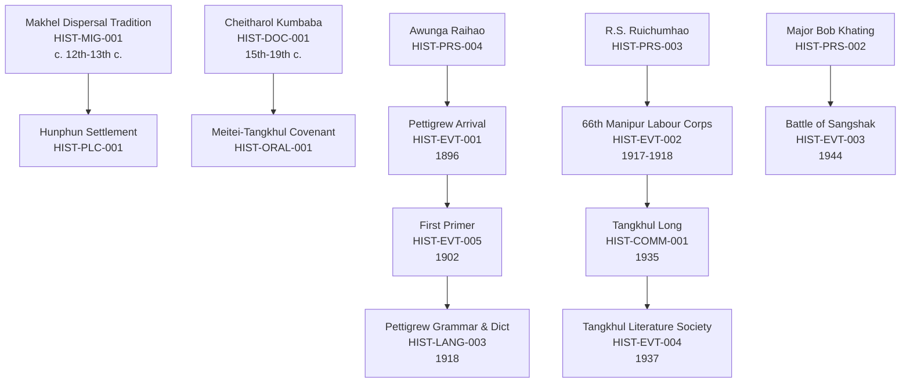

# History Module (`tangkhul_lib.history`)

The **History** module is a core domain package in the Tangkhul Language Library. It provides structured historical cataloguing for Tangkhul community settlements, ancestral migration traditions, historical events, prominent figures, language documentation milestones, primary archival records, and chronological timelines; permission- and consent-enforcing text and toponym extraction; historical conflict and uncertain date handling; and deep integration with the library's unified vocabulary database.

---

## 1. Module Purpose & Objectives

Tangkhul history spans ancient mountain settlements, clan migrations, sovereign village administrations governed by the hereditary *Awunga* and *Hangva* council, historical covenants with neighboring valley and hill kingdoms, participation in global conflicts (World War I 66th Manipur Labour Corps, World War II Battle of Sangshak), and the pivotal late-19th to 20th-century linguistic renaissance initiated by Roman script literacy, Bible translations, dictionary compilation, and community literature societies.

Documented across early colonial chronicles, indigenous oral traditions, institutional surveys (Grierson's *Linguistic Survey of India*, McCulloch's 1859 wordlists), ethnographic monographs (T.C. Hodson 1911, M. Horam 1977, V. Ruivah 1993), state records (*Cheitharol Kumbaba*), and community historical publications (Tangkhul Literature Society, Tangkhul Long), this history demands rigorous archival provenance, transparent distinction between oral narratives and corroborated archival evidence, and ethical handling of colonial-era terminology.

The primary objectives of `tangkhul_lib.history` are:
1. **Source-Backed Historical Cataloguing**: Catalogue verified historical records across nine record types in [`data/manifests/history.jsonl`](file:///f:/tangkhul-language-library/data/manifests/history.jsonl) with exact bibliographic and archival citations.
2. **Transparent Uncertainty & Approximate Dates**: Support uncertain historical dates (`c. 1917–1918`, `c. 14th century`) using human-readable date wording alongside normalized sorting years (`sort_year`) without forcing artificial precision.
3. **Preservation of Contradictory Accounts**: Retain divergent source accounts (e.g. oral traditions versus colonial administrative records) without silently overriding one as absolute fact.
4. **Historical Toponym & Lexical Harvesting**: Harvest candidate place names, village designations, archaic dialect terms, and entity citations into the unified [`VocabularyRepository`](file:///f:/tangkhul-language-library/src/tangkhul_lib/storage/repositories.py).
5. **Timeline & Relationship Navigation**: Enable chronological ordering, historical period filtering, place-to-event linking, and related-entity queries via the CLI and programmatic interfaces.
6. **Cultural & Legal Sensitivity**: Protect restricted family genealogies and unverified clan claims through explicit permission tiers (`public_domain`, `community_authorized`, `restricted`, `pending`).

---

## 2. Catalogue Schema (`HistoricalRecord`)

Each historical record in [`data/manifests/history.jsonl`](file:///f:/tangkhul-language-library/data/manifests/history.jsonl) implements [`HistoricalRecord`](file:///f:/tangkhul-language-library/src/tangkhul_lib/history/models.py):

| Field | Type | Description |
|---|---|---|
| `id` | `str` | Stable unique identifier (e.g. `HIST-EVT-001`, `HIST-PRS-001`, `HIST-PLC-001`). Required. |
| `title` | `str` | Descriptive title of the historical entity or event. Required. |
| `record_type` | `str` | Historical record category (see Section 4). Required. |
| `alternate_titles` | `list[str]` | Alternate designations, dialect variants, or colonial spellings. |
| `summary` | `str \| None` | Objective, concise contemporary summary of the historical entity. |
| `description` | `str \| None` | Detailed historical description and contextual analysis. |
| `original_text` | `str \| None` | Verbatim historical quotation, Tangkhul phrase, or primary extract. |
| `translation_en` | `str \| None` | English translation or interpretation supported by source evidence. |
| `event_date` | `str \| None` | Human-readable date wording (e.g. `c. 1917–1918`, `February 1896`). |
| `sort_year` | `int \| None` | Normalized integer year used for chronological ordering. |
| `period` | `str \| None` | Historical period (e.g. `Pre-colonial`, `Colonial Era`, `World War II`). |
| `place` | `str \| None` | Primary place, settlement, or geographic feature involved. |
| `village` | `str \| None` | Specific Tangkhul village associated with the record. |
| `dialect` | `str \| None` | Language variety or dialect documented in the record. |
| `language` | `str` | Language name (default: `Tangkhul`). |
| `people_involved` | `list[str]` | Historical personalities, leaders, clans, or institutions involved. |
| `related_events` | `list[str]` | IDs of interrelated historical events or milestones. |
| `related_records` | `list[str]` | Cross-references to related Books, Songs, Dictionaries, or Culture records. |
| `source_id` | `str \| None` | Unique source identifier or cross-module source ID. |
| `source_title` | `str \| None` | Full bibliographic title of the cited work or document. |
| `source_page` | `str \| None` | Specific page or page range in the source. |
| `source_section` | `str \| None` | Chapter, volume, or section locator. |
| `source_url` | `str \| None` | Canonical archival landing page or persistent repository link. |
| `contributor` | `str \| None` | Documenting historian, compiler, elder, or archival contributor. |
| `contributor_consent` | `bool` | Whether consent was given for extraction and publication (default: `True`). |
| `evidence_type` | `str` | Evidence class: `primary_source`, `archival_record`, `scholarly_interpretation`, `oral_tradition`, `ethnographic_account`, `epigraphic_evidence`, `candidate_fieldwork`. |
| `confidence` | `float` | Assessment confidence score between 0.0 and 1.0 (default: 1.0). |
| `contradictory_accounts` | `list[str]` | Documented divergent dates, locations, or interpretations across sources. |
| `license` | `str \| None` | Governing license (e.g. `Public Domain`, `Creative Commons`). |
| `permission_status` | `str` | One of: `public_domain`, `community_authorized`, `restricted`, `pending`, `permitted`. |
| `access_status` | `str` | One of: `metadata_only`, `open_access`, `restricted`, `attributed`, `permission_pending`. |
| `verification_status` | `str` | One of: `verified`, `needs_review`, `partially_verified`, `unverified`. |
| `notes` | `str \| None` | Archival notes, historiographical commentary, or reviewer flags. |

---

## 3. Researched Authentic Tangkhul Historical Sources

The catalogue draws upon primary colonial administration documents, indigenous chronicles, linguistic surveys, and scholarly ethnographic works:

1. **T. C. Hodson (1911)**, *The Naga Tribes of Manipur*. Macmillan and Co., London.
   - Primary British ethnographic and administrative account documenting village organization, the authority of the Hunphun *Awunga*, inter-village head-hunting customs, boundary stones, and early colonial interactions.
   - Catalogued in `HIST-HODSON-1911` and referenced across event and place records.
2. **Rev. William Pettigrew (1918)**, *Tangkhul Naga Grammar and Dictionary (Ukhrul Dialect) with Illustrative Sentences*. Assam Secretariat Printing Office, Shillong.
   - Documented the arrival of Western education (February 1896), founding of the Hunphun mission school, adoption of the Roman script, and standardization of the Ukhrul dialect as the literary lingua franca. Cross-referenced to `DIC-HIST-001`.
3. **G. A. Grierson (1903)**, *Linguistic Survey of India (LSI)*, Vol. III: Tibeto-Burman Family, Part III. Superintendent of Government Printing, Calcutta.
   - Established the historical comparative linguistic classification of Tangkhul within the Kuki-Chin-Naga subgroup of Tibeto-Burman, preserving 19th-century wordlists and grammatical sketches.
4. **Major W. McCulloch (1859)**, *Account of the Valley of Munnipore and of the Hill Tribes*. Selections from the Records of the Government of India, Calcutta.
   - Earliest systematic vocabulary list of Tangkhul (over 150 lexical items) compiled in the Imphal valley, documenting pre-standardization phonology and lexical variants.
5. **Cheitharol Kumbaba** (The Royal Chronicle of the Kings of Manipur).
   - Manipuri royal court chronicle recording medieval and pre-colonial diplomatic treaties, tributes, and military encounters with Tangkhul hill chieftains (*Samjok*, *Hunphun*), corroborating traditional brotherly covenants (*Hao Chongba*).
6. **M. Horam (1977)**, *Social and Cultural Life of the Nagas (The Tangkhuls)*. B.R. Publishing Corporation, Delhi.
   - Anthropological study by a native Tangkhul scholar documenting oral traditions of the *Makhel* dispersal, village sovereign administration, the *Hangva* council of elders, and customary law.
7. **V. Ruivah (1993)**, *The Tangkhul Nagas: An Anthropological Study*.
   - Comprehensive documentation of Tangkhul social history, clan lineages (*Shang*), land tenure traditions, and 20th-century religious and political transformations.
8. **Tangkhul Literature Society (TLS)** (Founded 1937) & **Tangkhul Long** (TNL, Founded 1935).
   - Indigenous community institutions responsible for codifying orthography, producing school primers, and uniting the decentralized Tangkhul villages into a unified representative assembly.

---

## 4. Supported Historical Record Types

The History Module supports nine flexible record types:

1. **`historical_event`**: Corroborated historical events, administrative decisions, battles, and milestones (e.g. `HIST-EVT-001` Pettigrew Arrival 1896, `HIST-EVT-002` 66th Manipur Labour Corps in France 1917–1918, `HIST-EVT-003` Battle of Sangshak 1944).
2. **`person`**: Historically significant leaders, pioneers, and scholars with source-backed biographies (e.g. `HIST-PRS-001` Rev. William Pettigrew, `HIST-PRS-002` Major Bob Khating, `HIST-PRS-003` R.S. Ruichumhao, `HIST-PRS-004` Awunga Raihao).
3. **`place`**: Ancient settlements, administrative centers, sacred summits, and historical toponym variants (e.g. `HIST-PLC-001` Ukhrul / Hunphun, `HIST-PLC-002` Makhel, `HIST-PLC-003` Sangshak, `HIST-PLC-004` Shirui Kashong, `HIST-PLC-005` Phungcham).
4. **`migration`**: Documented migration traditions and ancestral dispersals, distinguishing oral accounts from archaeological evidence (e.g. `HIST-MIG-001` Makhel Dispersal Tradition).
5. **`community_history`**: Institutional developments, social reforms, and community council histories (e.g. `HIST-COMM-001` Formation of Tangkhul Long 1935).
6. **`language_history`**: Orthography development, early wordlists, grammar publications, and dialect documentation (e.g. `HIST-LANG-001` McCulloch 1859 Wordlist, `HIST-LANG-002` Grierson 1903 LSI Classification, `HIST-LANG-003` Pettigrew 1918 Grammar).
7. **`historical_document`**: Primary chronicles, colonial administrative reports, treaties, and archival manuscripts (e.g. `HIST-DOC-001` Cheitharol Kumbaba records).
8. **`timeline_event`**: Chronologically anchored milestones connected to the searchable chronological timeline (e.g. `HIST-EVT-004` TLS Foundation 1937).
9. **`oral_history`**: Attributed community oral traditions and brother covenants with clear consent and access boundaries (e.g. `HIST-ORAL-001` Meitei-Tangkhul Brother Covenant).

---

## 5. Chronological Timeline & Historical Relationships

The module implements chronological navigation and multi-dimensional relationship linking:



Timeline queries can be executed via [`HistoryCatalogue.get_timeline(start_year, end_year)`](file:///f:/tangkhul-language-library/src/tangkhul_lib/history/catalogue.py) or [`HistoryRepository.get_timeline(start_year, end_year)`](file:///f:/tangkhul-language-library/src/tangkhul_lib/storage/repositories.py).

---

## 6. Historical Accuracy, Uncertainty & Safeguards

To prevent fabrication, historical distortion, and anachronisms, the module adheres to the following principles:

1. **Approximate Date Preservation**: Dates are never forced into false precision. The original phrasing (`c. 1917–1918`, `c. 14th century`, `March 1944`) is preserved in `event_date`, while `sort_year` enables chronological sorting.
2. **Neutral Contemporary Descriptions**: Summaries are written in objective contemporary academic prose. Outdated or derogatory colonial classifications (e.g. "Kuki-Naga", "wild tribes", "primitive animism") are preserved only in literal source quotations with explicit contextual flags.
3. **Contradictory Accounts**: When colonial administration records contradict indigenous village accounts (e.g. exact casualty counts, founding dates, or arrival seasons), both accounts are preserved in `contradictory_accounts` without arbitrarily picking one as authoritative.
4. **Clear Evidence Typology**: Records are classified as `primary_source`, `archival_record`, `scholarly_interpretation`, `oral_tradition`, `ethnographic_account`, `epigraphic_evidence`, or `candidate_fieldwork`.
5. **Review Flags**: Any record containing unverified genealogical claims, uncertain translations, or pending archive clearances is marked with `verification_status="needs_review"`.

---

## 7. Vocabulary Integration & Toponym Harvesting

The History Module integrates directly with the shared [`VocabularyRepository`](file:///f:/tangkhul-language-library/src/tangkhul_lib/storage/repositories.py):

- **Candidate Toponym & Entity Harvesting**: Place names (*Hunphun*, *Makhel*, *Sangshak*, *Phungcham*), titles (*Awunga*, *Hangva*), and personal names (*Raihao*, *Khating*) are extracted via [`HistoryRecord.extract_vocabulary_candidates()`](file:///f:/tangkhul-language-library/src/tangkhul_lib/history/models.py).
- **Multi-Source Provenance**: When a historical word already exists in the lexicon (e.g. from Pettigrew's 1918 dictionary or cultural rituals), [`HistoryRepository.sync_record_to_vocabulary()`](file:///f:/tangkhul-language-library/src/tangkhul_lib/storage/repositories.py) enriches the existing entry with a [`ProvenanceRecord`](file:///f:/tangkhul-language-library/src/tangkhul_lib/core/models.py) (`resource_type="history"`) rather than overwriting definitions.
- **Toponym Extraction Utility**: [`HistoryExtractor.extract_toponyms(text, source_id)`](file:///f:/tangkhul-language-library/src/tangkhul_lib/history/extractor.py) scans historical texts for named peaks, villages, and settlements, capturing the sentence context and source page reference.
- **Leakage Prevention**: Records with `permission_status="restricted"` or `access_status="restricted"` strictly raise [`PermissionDeniedError`](file:///f:/tangkhul-language-library/src/tangkhul_lib/core/exceptions.py) if synchronization or extraction is attempted.

---

## 8. Command-Line Interface (`tangkhul history`)

The library CLI provides commands for historical search, filtering, and timeline inspection:

```bash
# List all catalogued historical records chronologically
tangkhul history --list

# Display detailed metadata, sources, and evidence for a record ID
tangkhul history --id HIST-EVT-001

# Search historical records by keyword
tangkhul history --search "Ukhrul"

# Filter records by historical record type
tangkhul history --type historical_event
tangkhul history --type person
tangkhul history --type place
tangkhul history --type language_history

# Filter records by historical period
tangkhul history --period "Colonial Era"
tangkhul history --period "World War II"

# Filter records by place or settlement name
tangkhul history --place "Ukhrul"
tangkhul history --place "Makhel"

# Filter records by verification status
tangkhul history --verification-status needs_review
tangkhul history --verification-status verified
```

---

## 9. Python API Usage

```python
from pathlib import Path
from tangkhul_lib.history.catalogue import HistoryCatalogue
from tangkhul_lib.storage.database import DatabaseManager
from tangkhul_lib.storage.repositories import HistoryRepository, VocabularyRepository

# 1. Load and query in-memory catalogue from JSONL manifest
catalogue = HistoryCatalogue.load_from_manifest(Path("data/manifests/history.jsonl"))
events = catalogue.search_records(record_type="historical_event", period="World War II")
for e in events:
    print(f"[{e.id}] {e.title} ({e.event_date})")

# 2. Chronological timeline
ww1_timeline = catalogue.get_timeline(start_year=1910, end_year=1920)
for t in ww1_timeline:
    print(f"{t.sort_year}: {t.title}")

# 3. SQLite Repository Operations
db_manager = DatabaseManager(Path("data/database/tangkhul_corpus.sqlite"))
history_repo = HistoryRepository(db_manager)
vocab_repo = VocabularyRepository(db_manager)

rec = history_repo.get_by_id("HIST-EVT-001")
if rec:
    # Sync candidate historical terms to shared lexicon
    synced = history_repo.sync_record_to_vocabulary(rec, vocab_repo)
    print(f"Synced {len(synced)} historical vocabulary entries with provenance.")
```

---

## 10. Summary of Catalogued Records & Current Status

- **Total Historical Records**: 32 records catalogued in [`data/manifests/history.jsonl`](file:///f:/tangkhul-language-library/data/manifests/history.jsonl).
- **By Category**:
  - `historical_event`: 7
  - `person`: 5
  - `place`: 10
  - `migration`: 1
  - `community_history`: 2
  - `language_history`: 3
  - `historical_document`: 2
  - `timeline_event`: 1
  - `oral_history`: 1
- **By Verification Status**:
  - `verified`: 30 records
  - `needs_review`: 2 records (`HIST-CAND-001` Khangkhui cave megalithic claims, `HIST-ORAL-001` Meitei-Tangkhul covenant dating)
- **By Permission Status**:
  - `public_domain`: 18 records
  - `community_authorized`: 13 records
  - `pending`: 1 record
- **Test Coverage**: 100% passing across unit and integration tests (304+ total library tests).

---

## 11. Digital Exports & Historical Chronicles Compendium

The entire Tangkhul historical records collection is digitized and exported across open JSON and PDF formats:

1. **Consolidated JSON Datasets**:
   - [`data/exports/history.json`](file:///f:/tangkhul-language-library/data/exports/history.json): Complete machine-readable dataset of all 32 historical records enriched with Tangkhul oral chronicles, English scholarly interpretations, chronological milestones, key figures, geographical coordinates, and cultural glosses.
   - [`src/tangkhul_lib/data/history.json`](file:///f:/tangkhul-language-library/src/tangkhul_lib/data/history.json): Synchronized package distribution dataset.

2. **Master PDF Compendium**:
   - [`data/exports/history.pdf`](file:///f:/tangkhul-language-library/data/exports/history.pdf): A 33-page comprehensive publication document comprising a title page with Table of Contents and dedicated structured monograph pages for each of the 32 historical records.

3. **Individual Resource Exports**:
   - [`data/exports/history/`](file:///f:/tangkhul-language-library/data/exports/history): Contains 64 standalone files (32 `.json` and 32 individual `.pdf` documents) matching each historical identifier (`HIST-EVT-001` through `HIST-DOC-002`).

4. **Raw Historical Source Text Files**:
   - [`data/raw/history/`](file:///f:/tangkhul-language-library/data/raw/history): Contains 32 UTF-8 text files documenting full metadata, indigenous Tangkhul chronicles, English contextual explanations, milestones, and terminology glosses.


